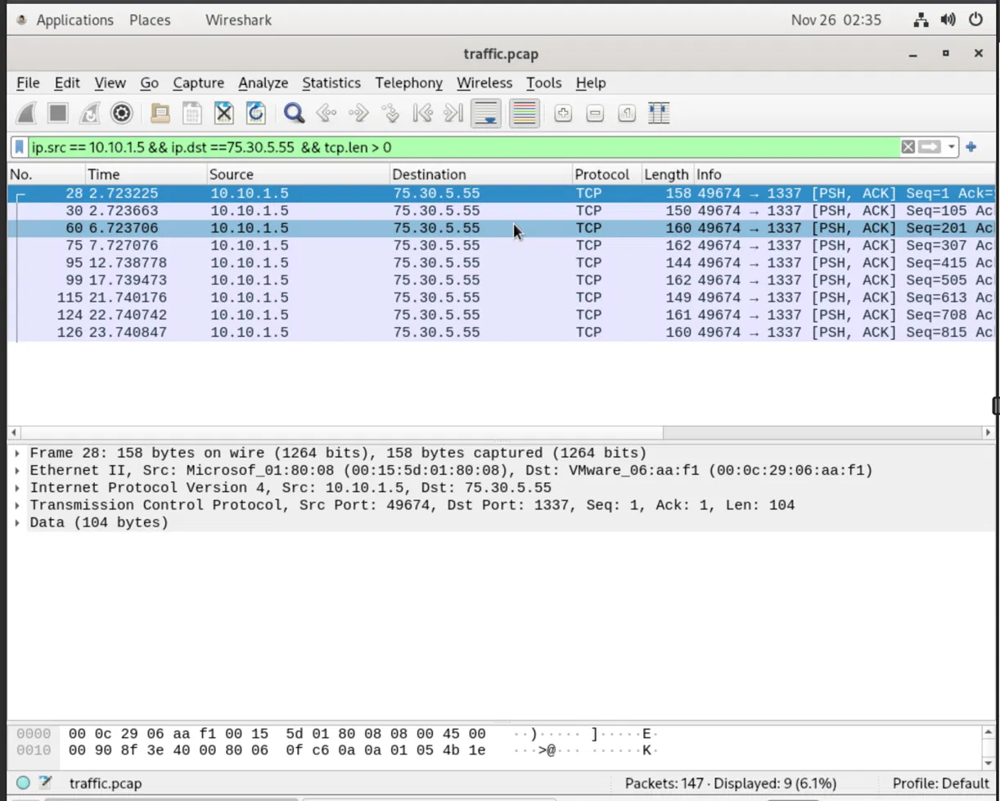
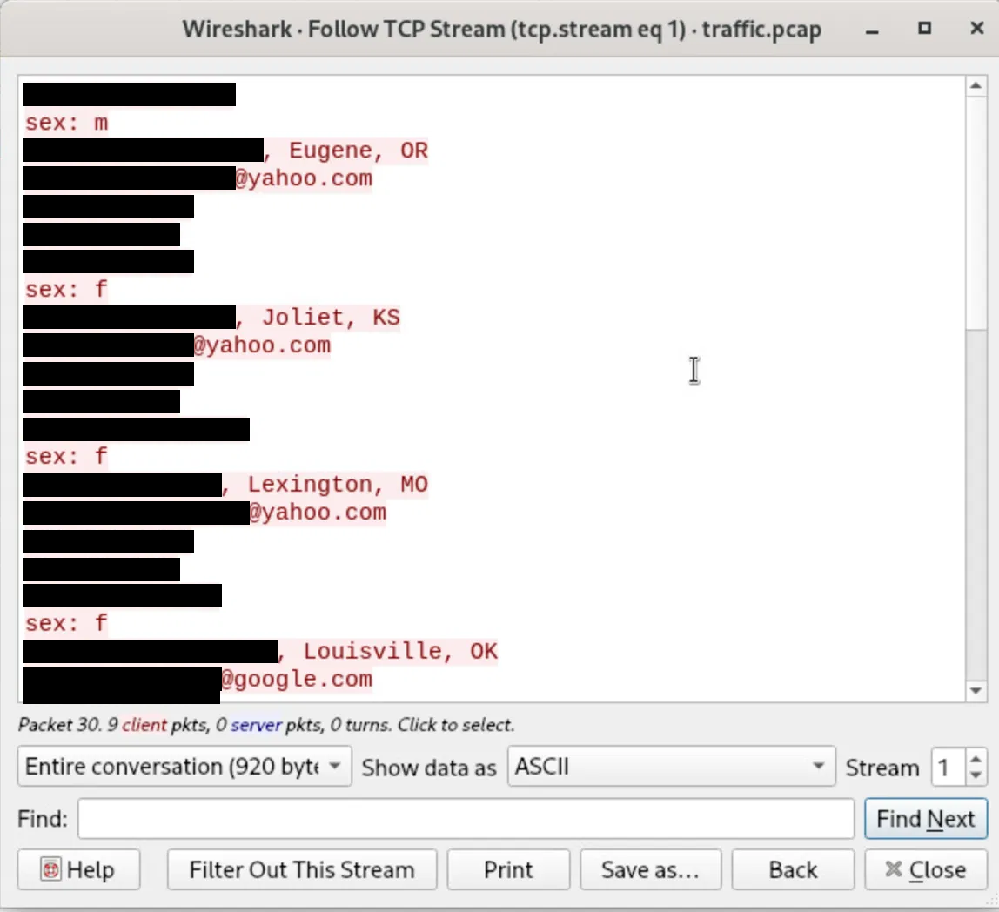
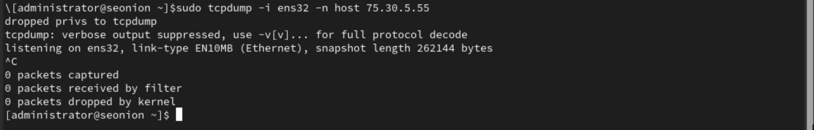
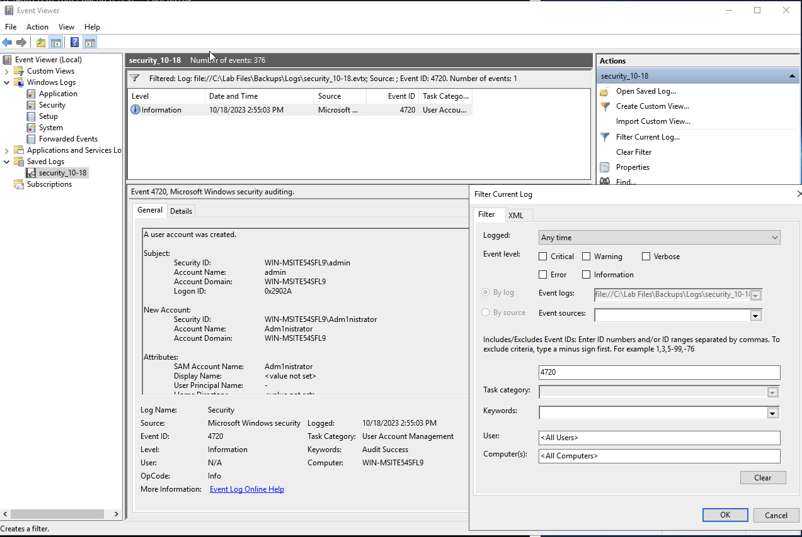

# Windows Server Breach: Incident Response Investigation


**Author:** Kristopher Neumann

A documented rerun of a Windows Server 2019 breach investigation from my CompTIA coursework, completed in an isolated virtual lab. I re-performed the investigation, captured my own evidence, and added the governance layer the course lab does not cover: a risk register, framework mapping, root-cause gap analysis, and lessons learned.

> **Lab disclosure.** This is training-lab work on an intentionally compromised VM. No production systems or real organizations are involved. The scenario comes from my CompTIA course; all screenshots, captures, and analysis here are from my own rerun. I used AI assistance for planning, review, and drafting. I performed the lab steps myself and verified framework control IDs against official sources before publishing.

## At a glance

| | |
|---|---|
| **Scenario** | Customer-data leak at an e-commerce client (course lab scenario, rerun in an isolated VM) |
| **Found** | Typosquatted process `WinT0Ols.exe` sending nine clear-text transmissions to `75.30.5.55:1337`, plus a lookalike admin account created by `admin` about 14 days before the capture |
| **Fixed** | Ended the process, disabled then removed `Adm1nistrator`, deleted the executable; verified with `netstat`, `tcpdump`, and a drive-wide search |
| **Added beyond the lab** | Framework crosswalk (NIST CSF 2.0, SP 800-53, CIS v8, ISO 27001), five-item risk register, root-cause gaps, privacy/breach assessment, lessons learned |
| **Stated gaps** | No persistence checks; alert console unreachable, so detection came from manual PCAP review |

## Scenario

The course scenario casts me as a security analyst at a fictional cybersecurity firm. A large e-commerce client reports possible customer-data leaks from one of its satellite offices: customers say they received phishing emails and vishing calls after talking with the Sales team. The task is to find the source and scope of the leak, stop further damage, and report findings, impact, root cause, and recommendations.

On the compromised Windows Server 2019 host I found a suspicious executable (`WinT0Ols.exe`, a lookalike name), a lookalike local account (`Adm1nistrator`, created per Event ID 4720 by the existing `admin` account), and outbound traffic to an external address on TCP port 1337. I identified it through host checks and manual review of a PCAP from the Security Onion sensor. The lab did not present an alert for this traffic, and I could not reach the Security Onion alert console to check, so how the activity was detected is unverified. I contained and cleaned up the host, then added the risk analysis the lab doesn't cover.

`75.30.5.55` is a public-range address used by the lab scenario inside the isolated environment; no real systems were involved.

## Lab objectives and what I completed

The lab lists five objectives, each tied to CompTIA Security+ (SY0-701) objectives. This table shows where my rerun stands on each, including the gaps.

| Objective | Security+ objectives | Status in this repo |
|---|---|---|
| Investigate the incident | 4.8, 4.9 | Done: host and PCAP evidence, Event 4720 |
| Analyze logs for anomalies tied to the packet capture | 2.4 | Done: Event 4720 correlated with the PCAP (about 14 days apart) |
| Identify the nature, source, affected systems, and impact | 4.8 | Done for source IP, affected host, and exposed data type. Attacker domain and email were not identified. |
| Remediate (remove anomalous files, restrict access, add controls) | 4.1, 4.5 | Mostly done: process ended, account disabled and then removed, and the executable deleted from disk. Persistence checks and permission changes were not performed; they are recommendations. |
| Monitor for further suspicious activity | 4.4, 3.2 | Partial: containment checked with `netstat` and `tcpdump`. No ongoing alerting was configured; it is a recommendation. |

The scenario's phishing and vishing reports are consistent with customer data having been exposed, but this capture alone does not prove the link.

## Key findings

| # | Finding | Evidence |
|---|---|---|
| 1 | Malicious process `WinT0Ols.exe` sending nine transmissions to `75.30.5.55:1337` with irregular 1-5 second gaps (two back-to-back) | Wireshark Conversations, time-delta view |
| 2 | Exfiltration over raw TCP (not HTTP): 9 records, 920 payload bytes, 1,406 bytes on the wire, six categories of personal-data-style fields (name, sex, address, email, phone, ID-formatted number), in a ~27 s capture | Follow TCP Stream, Capture File Properties |
| 3 | Unauthorized lookalike admin account `Adm1nistrator` (password never expires), created by the `admin` account on 2023-10-18 14:55:03 (host local time), per the saved Security log | Event ID 4720, Local Users and Groups |
| 4 | Containment validated: PID 6068 ended in Task Manager and the account disabled; `netstat` showed no connections and a `tcpdump` capture on the sensor showed 0 packets to the destination | netstat, tcpdump output (own captures) |
| 5 | No alert was presented for the 1337 traffic and the Security Onion console was unreachable from the lab VMs; detection came from manual PCAP review | Browser error (console unreachable) |
| 6 | About 14 days between account creation (2023-10-18 14:55:03, host local time) and the PCAP's first packet (2023-11-01 18:07:33, capture metadata), suggesting undetected dwell time; the two clocks come from different sources, so approximate | Event log vs. Capture File Properties |

## Evidence highlights

Full list in [`evidence/evidence_index.md`](evidence/evidence_index.md).

| | |
|---|---|
|  |  |
| **Nine outbound transmissions** from 10.10.1.5 to 75.30.5.55 on TCP 1337 (evidence 03) | **Clear-text payload:** six fields per record, 920 bytes, no server reply. Identifying values redacted (evidence 10) |
|  |  |
| **Containment check:** 0 packets to the destination after the process was ended (evidence 09) | **Event 4720:** lookalike account created by `admin` (evidence 04) |

## Scope and limits

Stated plainly so nothing here is overclaimed:

- Containment was validated by network capture and `netstat`. I deleted the malicious executable and confirmed with a full-drive search that no file named `WinT0*` remains. Persistence checks (Run keys, scheduled tasks, services, startup folders) were outside the scope of this rerun, so they appear as recommendations rather than completed steps.
- Analysis covers one host and one capture.
- Framework mappings are my own analysis, not an audit.

## GRC layer

See [`grc/`](grc/):

- `framework_crosswalk.md`: findings mapped to NIST CSF 2.0, NIST SP 800-53 Rev 5, CIS Controls v8, ISO/IEC 27001:2022 Annex A
- `risk_register.csv`: likelihood/impact scoring, owner, treatment, residual risk. Score = likelihood × impact (1-5 each); Critical 20-25, High 12-19, Medium 6-11, Low 1-5. Owners are role-based, not named people.
- `root_cause_gaps.md`: process-level failures behind the findings
- `lessons_learned.md`: post-incident review per NIST SP 800-61 Rev. 2
- `privacy_breach_assessment.md`: data exposure and notification considerations

## Repository structure

**Where to start:** technical reviewers, go to [`evidence/evidence_index.md`](evidence/evidence_index.md) and [`docs/investigation_report.md`](docs/investigation_report.md). GRC reviewers, go to [`grc/framework_crosswalk.md`](grc/framework_crosswalk.md) and [`grc/risk_register.csv`](grc/risk_register.csv).

```
windows-server-incident-response-investigation/
├── README.md
├── docs/investigation_report.md
├── evidence/            # my own screenshots + evidence_index.md
└── grc/
```

## Skills demonstrated

Packet analysis (Wireshark, TCP stream reconstruction) · Windows host investigation (`netstat`, `tasklist`, Event Viewer, local accounts) · Containment and eradication · Control framework mapping · Risk register development · Root-cause analysis

## Contact

Kristopher Neumann: www.linkedin.com/in/krisneumann
